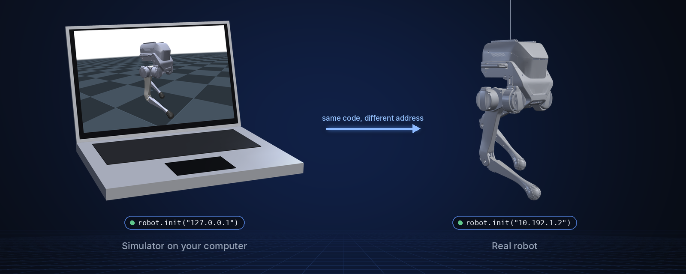

<p align="center">
  
</p>

<p align="center">
  <b>English</b> | <a href="README_cn.md">中文</a>
</p>

<p align="center">
  <a href="LICENSE"></a>
  
  
  
</p>

# limxsdk-lowlevel

The low-level motion-control SDK for LimX robots: read joint states, IMU and
the remote controller, and send joint commands, from C++ or Python. The same
code drives a simulator on your computer or the real robot.

> **Scope:** prebuilt libraries (`lib/`), headers (`include/`), Python wheels
> (`python3/`) and examples. The SDK's source code is not part of this
> repository.

## Highlights

- **One API, several robots.** Pick the robot with one type:
  `PointFoot`, `Wheellegged`, `Tron2`, `Centaur` or `Humanoid`.
- **C++ and Python.** The Python wheel exposes the same calls as the C++
  library.
- **Simulation and hardware alike.** `init("127.0.0.1")` talks to a simulator
  on your computer, `init("10.192.1.2")` to the robot.
- **No ROS required.** Plain CMake works; the same `CMakeLists.txt` also
  builds as a ROS 1 (catkin) or ROS 2 (ament) package.
- **Prebuilt for your platform.** Linux x86_64, aarch64 and arm32, and Windows.

## Supported robots

| | Robot type | Robots | Example |
|:-:|---|---|---|
|  | `PointFoot` | TRON1 (point-foot, sole-foot, wheel-foot) | [`example_tron1.py`](python3/examples/api/example_tron1.py) |
|  | `Tron2` | TRON2 | [`example_tron2.py`](python3/examples/api/example_tron2.py) |
|  | `Centaur` | TRON2 DASF (lower body and upper body as two channels) | [`example_centaur.py`](python3/examples/api/example_centaur.py) |
|  | `Humanoid` | LimX humanoid (HU_D04) | [`example_humanoid.py`](python3/examples/api/example_humanoid.py) |
| | `Wheellegged` | Wheel-legged robots | none in this repository |

## How it works

<p align="center">
  
</p>

Your program subscribes to `RobotState` (joint `q`, `dq`, `tau`), `ImuData`
and `SensorJoy`, and publishes `RobotCmd` (per joint `q`, `dq`, `tau`, `Kp`,
`Kd`), typically at 1 kHz. A simulator does the opposite with the `*ForSim`
calls, which is how [tron1-mujoco-sim](https://github.com/limxdynamics/tron1-mujoco-sim),
[tron2_mujoco_sim](https://github.com/limxdynamics/tron2_mujoco_sim) and
[humanoid-mujoco-sim](https://github.com/limxdynamics/humanoid-mujoco-sim) plug in.

## Quick start

Python, on Linux x86_64 (use `python3/aarch64/` on ARM):

```bash
git clone https://github.com/limxdynamics/limxsdk-lowlevel.git
cd limxsdk-lowlevel
pip install python3/amd64/limxsdk-*.whl
export ROBOT_TYPE=PF_TRON1A          # TRON1 only, see below
```

Then read the joint positions of a TRON1, here in
[tron1-mujoco-sim](https://github.com/limxdynamics/tron1-mujoco-sim) running
on the same computer:

```python
import time
import limxsdk.robot.Robot as Robot
import limxsdk.robot.RobotType as RobotType

robot = Robot(RobotType.PointFoot)
robot.init("127.0.0.1")            # "10.192.1.2" for the real robot
print(robot.getMotorNames())
robot.subscribeRobotState(lambda s: print("q =", list(s.q)))
while True:
    time.sleep(1)                  # Ctrl+C to stop
```

To send commands, start from the examples in
[`python3/examples/api/`](python3/examples/api/).

C++, without ROS (needs CMake and Eigen, `sudo apt install cmake libeigen3-dev`):

```bash
mkdir build && cd build
cmake .. -DCMAKE_INSTALL_PREFIX=$HOME/limxsdk
make -j && make install          # examples land in $HOME/limxsdk/bin
```

> **TRON1 needs `ROBOT_TYPE`.** For `PointFoot`, `init()` reads the
> `ROBOT_TYPE` environment variable and fails without it. Use the model name,
> for example `PF_TRON1A`, `SF_TRON1A` or `WF_TRON1A` (6 motors for
> point-foot, 8 for sole-foot and wheel-foot).

## 1. Set Up Development Environment

For algorithm developers, we recommend setting up a ROS Noetic-based development environment on **Ubuntu 20.04**. ROS provides a suite of tools and libraries—such as core libraries, communication frameworks, and simulation tools like **Gazebo**—which greatly simplify the development, testing, and deployment of robot algorithms. These resources offer a rich and comprehensive environment for algorithm development.

Of course, even without ROS, you can still develop your motion control algorithm in other environments. The motion control SDK we provide is **dependency-free**, based on standard **C++11 and Python**, and supports cross-platform and cross-OS development, offering developers greater flexibility.

To install ROS Noetic, please refer to the official documentation:  
[https://wiki.ros.org/noetic/Installation/Ubuntu](https://wiki.ros.org/noetic/Installation/Ubuntu)  
Select `ros-noetic-desktop-full` for installation.

Once ROS Noetic is installed, run the following shell command in a terminal to install the required dependencies:

```
sudo apt-get update
sudo apt install ros-noetic-urdf \
                 ros-noetic-kdl-parser \
                 ros-noetic-urdf-parser-plugin \
                 ros-noetic-hardware-interface \
                 ros-noetic-controller-manager \
                 ros-noetic-controller-interface \
                 ros-noetic-controller-manager-msgs \
                 ros-noetic-control-msgs \
                 ros-noetic-ros-control \
                 ros-noetic-gazebo-* \
                 ros-noetic-rqt-gui \
                 ros-noetic-rqt-controller-manager \
                 ros-noetic-plotjuggler* \
                 cmake build-essential libpcl-dev libeigen3-dev libopencv-dev libmatio-dev \
                 python3-pip libboost-all-dev libtbb-dev liburdfdom-dev liborocos-kdl-dev -y
```

## 2. Create Workspace

Follow the steps below to create an algorithm development workspace:

### Step 1: Open a terminal

### Step 2: Create a new workspace directory

```bash
mkdir -p ~/limx_ws/src
```

### Step 3: Clone required repositories

#### Clone the motion control SDK:

```bash
cd ~/limx_ws/src
git clone https://github.com/limxdynamics/limxsdk-lowlevel.git
```

#### Clone Gazebo simulator plugins:

```bash
cd ~/limx_ws/src
git clone https://github.com/limxdynamics/pointfoot-gazebo-ros.git
```

#### Clone robot model description files:

```bash
cd ~/limx_ws/src
git clone https://github.com/limxdynamics/robot-description.git
```

#### Clone visualization debugging tools:

```bash
cd ~/limx_ws/src
git clone https://github.com/limxdynamics/robot-visualization.git
```

### Step 4: Compile the workspace

```bash
cd ~/limx_ws
catkin_make install
```

## 3. Python Motion Control SDK

### 3.1 Overview

We provide a Python interface with the same functionality as the C++ SDK. This allows developers unfamiliar with C++ to write motion control algorithms in Python. Python’s simplicity, clear syntax, and rich third-party ecosystem enable developers to get started quickly and iterate faster.

With the Python interface, developers can benefit from:

- Rapid prototyping and testing
- Cross-platform support
- Easy integration of reinforcement learning (RL) models into both simulation and real hardware environments

This flexibility accelerates algorithm development and deployment.

### 3.2 Install Python SDK

Please install the appropriate `.whl` file depending on your platform:

#### On Linux x86_64:

```bash
pip install python3/amd64/limxsdk-*.whl
```

#### On Linux aarch64:

```bash
pip install python3/aarch64/limxsdk-*.whl
```

#### On Windows:

```bash
pip install python3/win/limxsdk-*.whl
```

### 3.3 Python Example

You can refer to the example Python script here:  
[python3/examples/api/](python3/examples/api/)

## 4. API at a glance

Every robot type derives from `ApiBase` (`include/limxsdk/apibase.h`):

| Call | What it does |
|---|---|
| `init(ip)` | Connect; `127.0.0.1` for a simulator, `10.192.1.2` for the robot |
| `getMotorNumber()`, `getMotorNames()` | Number and names of the motors |
| `subscribeRobotState(cb)` | Joint `q`, `dq`, `tau` |
| `subscribeImuData(cb)` | Accelerometer, gyroscope, orientation quaternion |
| `publishRobotCmd(cmd)` | Per-joint `q`, `dq`, `tau`, `Kp`, `Kd` (and `mode`) |
| `subscribeSensorJoy(cb)` | Remote controller axes and buttons |
| `subscribeDiagnosticValue(cb)` | Health reports such as `imu`, `ethercat`, `calibration` |
| `setRobotLightEffect(effect)` | Robot light effect |
| `publishJsonMessage(json)`, `subscribeJsonMessage(cb)` | High-level JSON API requests and notifications |
| `subscribeRobotCmdForSim(cb)`, `publishRobotStateForSim(state)`, `publishImuDataForSim(imu)` | Simulator side |

`Tron2` and `Centaur` add calls for grippers, hands, the chassis and lifter,
and the upper body; see their headers and the Python examples in
[`python3/examples/api/`](python3/examples/api/).

## License

Apache License 2.0; see [LICENSE](LICENSE).
