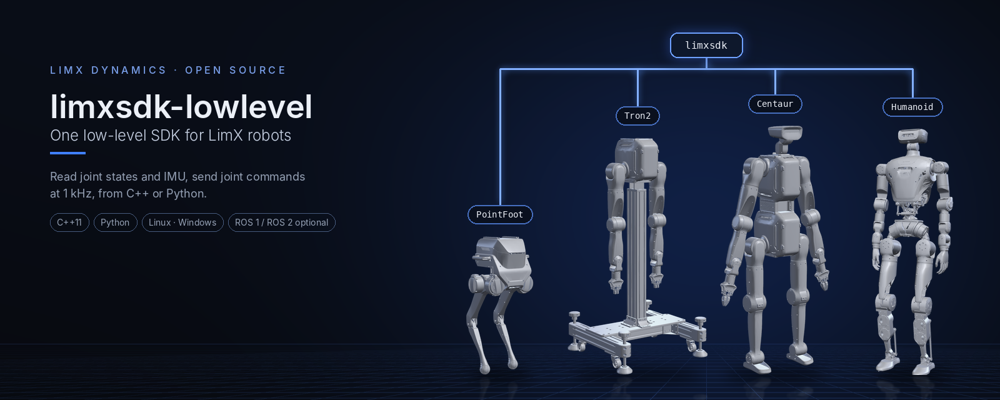
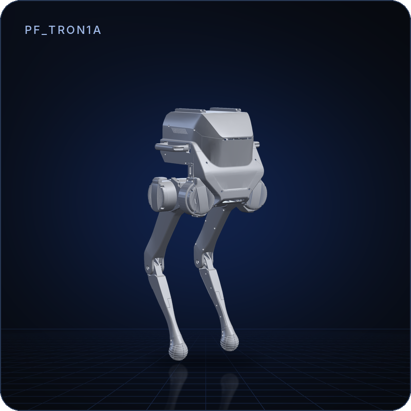
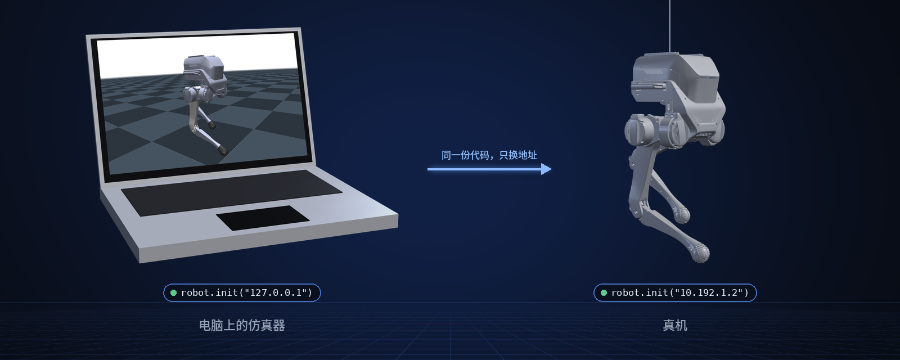

<p align="center">
  
</p>

<p align="center">
  <a href="README.md">English</a> | <b>中文</b>
</p>

<p align="center">
  <a href="LICENSE"></a>
  
  
  
</p>

# limxsdk-lowlevel

LimX 机器人的底层运动控制 SDK：用 C++ 或 Python 读取关节状态、IMU 和遥控器数据，下发关节指令。
同一份代码既能连电脑上的仿真器，也能连真机。

> **范围：** 预编译库（`lib/`）、头文件（`include/`）、Python wheel（`python3/`）和示例。
> 本仓库不包含 SDK 源码。

## 亮点

- **一套接口，多款机器人。** 用一个类型选择机器人：`PointFoot`、`Wheellegged`、`Tron2`、`Centaur` 或 `Humanoid`。
- **C++ 和 Python。** Python wheel 提供与 C++ 库相同的调用。
- **仿真和真机一样用。** `init("127.0.0.1")` 连本机仿真器，`init("10.192.1.2")` 连机器人。
- **不依赖 ROS。** 用普通 CMake 即可编译；同一个 `CMakeLists.txt` 也能作为 ROS 1（catkin）或 ROS 2（ament）功能包编译。
- **各平台预编译。** Linux x86_64、aarch64、arm32 和 Windows。

## 支持的机器人

| | 机器人类型 | 机器人 | 示例 |
|:-:|---|---|---|
|  | `PointFoot` | TRON1（点足、双足、轮足） | [`example_tron1.py`](python3/examples/api/example_tron1.py) |
|  | `Tron2` | TRON2 | [`example_tron2.py`](python3/examples/api/example_tron2.py) |
|  | `Centaur` | TRON2 DASF（下半身与上半身为两个通道） | [`example_centaur.py`](python3/examples/api/example_centaur.py) |
|  | `Humanoid` | LimX 人形机器人（HU_D04） | [`example_humanoid.py`](python3/examples/api/example_humanoid.py) |
| | `Wheellegged` | 轮腿机器人 | 本仓库暂无示例 |

## 工作原理

<p align="center">
  
</p>

你的程序订阅 `RobotState`（关节 `q`、`dq`、`tau`）、`ImuData` 和 `SensorJoy`，发布 `RobotCmd`
（每个关节的 `q`、`dq`、`tau`、`Kp`、`Kd`），通常为 1 kHz。仿真器用 `*ForSim` 系列接口做相反的事，
[tron1-mujoco-sim](https://github.com/limxdynamics/tron1-mujoco-sim)、
[tron2_mujoco_sim](https://github.com/limxdynamics/tron2_mujoco_sim) 和
[humanoid-mujoco-sim](https://github.com/limxdynamics/humanoid-mujoco-sim) 就是这样接入的。

## 快速开始

Python，Linux x86_64（ARM 用 `python3/aarch64/`）：

```bash
git clone https://github.com/limxdynamics/limxsdk-lowlevel.git
cd limxsdk-lowlevel
pip install python3/amd64/limxsdk-*.whl
export ROBOT_TYPE=PF_TRON1A          # 仅 TRON1 需要，见下文
```

然后读取 TRON1 的关节位置，这里连接的是本机运行的
[tron1-mujoco-sim](https://github.com/limxdynamics/tron1-mujoco-sim)：

```python
import time
import limxsdk.robot.Robot as Robot
import limxsdk.robot.RobotType as RobotType

robot = Robot(RobotType.PointFoot)
robot.init("127.0.0.1")            # 真机用 "10.192.1.2"
print(robot.getMotorNames())
robot.subscribeRobotState(lambda s: print("q =", list(s.q)))
while True:
    time.sleep(1)                  # Ctrl+C 退出
```

下发指令请参考 [`python3/examples/api/`](python3/examples/api/) 中的示例。

C++，不使用 ROS（需要 CMake 和 Eigen：`sudo apt install cmake libeigen3-dev`）：

```bash
mkdir build && cd build
cmake .. -DCMAKE_INSTALL_PREFIX=$HOME/limxsdk
make -j && make install          # 示例程序安装到 $HOME/limxsdk/bin
```

> **TRON1 需要 `ROBOT_TYPE`。** 对 `PointFoot`，`init()` 会读取环境变量 `ROBOT_TYPE`，未设置时失败。
> 填写型号名，例如 `PF_TRON1A`、`SF_TRON1A` 或 `WF_TRON1A`（点足 6 个电机，双足和轮足 8 个）。

## 1. 搭建开发环境

在算法开发者自己的电脑中，我们推荐在 Ubuntu 20.04 操作系统上建立基于 ROS Noetic 的算法开发环境。ROS 提供了一系列工具和库，如核心库、通信库和仿真工具（如 Gazebo），极大地便利了机器人算法的开发、测试和部署。这些资源为用户提供了一个丰富而完整的算法开发环境。

当然，即使没有 ROS，您也可以选择在其他环境中开发自己的运动控制算法。我们提供的运动控制开发接口，是一个基于标准 C++11 和 Python 的无依赖 SDK。它支持跨操作系统和平台调用开发，为开发者提供了更灵活的选择。

ROS Noetic 安装请参考文档：https://wiki.ros.org/noetic/Installation/Ubuntu ，选择“ros-noetic-desktop-full”进行安装。ROS Noetic 安装完成后，Bash 终端输入以下 Shell 命令，安装开发环境所依赖的库：

```
sudo apt-get update
sudo apt install ros-noetic-urdf \
                 ros-noetic-kdl-parser \
                 ros-noetic-urdf-parser-plugin \
                 ros-noetic-hardware-interface \
                 ros-noetic-controller-manager \
                 ros-noetic-controller-interface \
                 ros-noetic-controller-manager-msgs \
                 ros-noetic-control-msgs \
                 ros-noetic-ros-control \
                 ros-noetic-gazebo-* \
                 ros-noetic-rqt-gui \
                 ros-noetic-rqt-controller-manager \
                 ros-noetic-plotjuggler* \
                 cmake build-essential libpcl-dev libeigen3-dev libopencv-dev libmatio-dev \
                 python3-pip libboost-all-dev libtbb-dev liburdfdom-dev liborocos-kdl-dev -y
```

## 2. 创建工作空间

可以按照以下步骤，创建一个算法开发工作空间：

- 打开一个 Bash 终端。

- 创建一个新目录来存放工作空间。例如，可以在用户的主目录下创建一个名为“limx_ws”的目录：

  ```
  mkdir -p ~/limx_ws/src
  ```

- 下载运动控制开发接口：

  ```
  cd ~/limx_ws/src
  git clone https://github.com/limxdynamics/limxsdk-lowlevel.git
  ```

- 下载 Gazebo 仿真器：

  ```
  cd ~/limx_ws/src
  git clone https://github.com/limxdynamics/pointfoot-gazebo-ros.git
  ```

- 下载机器人模型描述文件

  ```
  cd ~/limx_ws/src
  git clone https://github.com/limxdynamics/robot-description.git
  ```

- 下载可视化调试工具

  ```
  cd ~/limx_ws/src
  git clone https://github.com/limxdynamics/robot-visualization.git
  ```

- 编译工程：

  ```
  cd ~/limx_ws
  catkin_make install
  ```


## 3. Python 运动控制开发接口

### 3.1 概述

提供与 C++相同功能的[Python 运动算法开发接口](https://github.com/limxdynamics/limxsdk-lowlevel/tree/master/python3)，使得不熟悉 C++编程语言的开发者能够使用 Python 进行运动控制算法的开发。Python 语言易于学习，具有简洁清晰的语法和丰富的第三方库，使开发者能够更快速地上手并迅速实现算法。通过 Python 接口，开发者可以利用 Python 的动态特性进行快速原型设计和实验验证，加速算法的迭代和优化过程。同时，Python 的跨平台性和强大的生态系统支持，使得运动算法能够更广泛地应用于不同平台和环境。此外，RL（强化学习）模型的快速部署到仿真和真机环境中也得益于 Python 的灵活性，开发者可以使用 Python 轻松地将 RL 模型集成到各种仿真平台和真实硬件中，实现快速迭代和验证算法的性能。

### 3.2 安装运动控制开发库

请根据操作系统选择相应的命令：

- Linux x86_64 平台

  ```Bash
  pip install python3/amd64/limxsdk-*.whl
  ```

- Linux aarch64 平台

  ```Bash
  pip install python3/aarch64/limxsdk-*.whl
  ```

- Windows  平台

  ```Bash
  pip install python3/win/limxsdk-*.whl
  ```

### 3.3 参考例程

Python 接口参考例程: [python3/examples/api/](python3/examples/api/)

## 4. 接口速览

所有机器人类型都继承自 `ApiBase`（`include/limxsdk/apibase.h`）：

| 调用 | 作用 |
|---|---|
| `init(ip)` | 建立连接；仿真器用 `127.0.0.1`，真机用 `10.192.1.2` |
| `getMotorNumber()`、`getMotorNames()` | 电机数量和名称 |
| `subscribeRobotState(cb)` | 关节 `q`、`dq`、`tau` |
| `subscribeImuData(cb)` | 加速度计、陀螺仪、姿态四元数 |
| `publishRobotCmd(cmd)` | 每个关节的 `q`、`dq`、`tau`、`Kp`、`Kd`（及 `mode`） |
| `subscribeSensorJoy(cb)` | 遥控器摇杆和按键 |
| `subscribeDiagnosticValue(cb)` | 健康状态，如 `imu`、`ethercat`、`calibration` |
| `setRobotLightEffect(effect)` | 机器人灯效 |
| `publishJsonMessage(json)`、`subscribeJsonMessage(cb)` | 高层 JSON 接口的请求与通知 |
| `subscribeRobotCmdForSim(cb)`、`publishRobotStateForSim(state)`、`publishImuDataForSim(imu)` | 仿真器侧 |

`Tron2` 和 `Centaur` 另有夹爪、灵巧手、底盘与升降、上半身等接口，见各自头文件和
[`python3/examples/api/`](python3/examples/api/) 中的 Python 示例。

## 许可证

Apache License 2.0，见 [LICENSE](LICENSE)。
